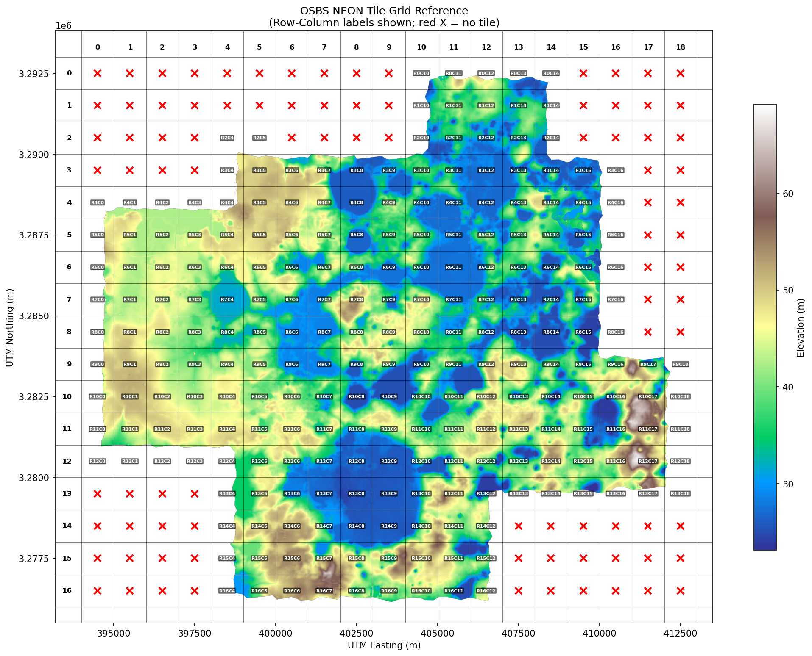
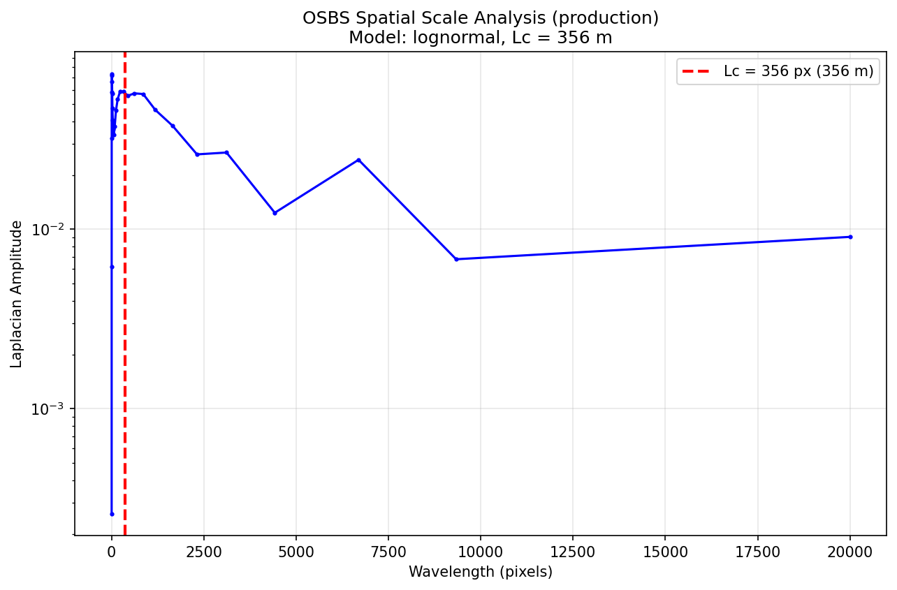

# OSBS Hillslope Methodology

*Representative hillslope parameters for OSBS from 1m NEON LIDAR following Swenson & Lawrence (2025).*

---

This page describes the methods used to produce the hillslope parameter file for OSBS. The methodology follows Swenson & Lawrence (2025) with adaptations for UTM CRS and 1m resolution. The pipeline was verified by reproducing Swenson's published data (see [MERIT Validation](merit-validation.md)) and reviewed in two internal audit reports: a full pipeline audit with equation-by-equation verification (2026-03-10) and a line-by-line divergence audit against Swenson's original code (2026-03-16). Both are in [`swenson/audit/260310-osbs_pipeline_and_docs/`](https://github.com/cdevaneprugh/hpg-esm-tools/tree/main/swenson/audit/260310-osbs_pipeline_and_docs).

---

## Study Domain and Data

### NEON LIDAR

| Property | Value |
|----------|-------|
| Dataset | NEON DP3.30024.001 (Elevation - LiDAR) |
| Site | OSBS (Ordway-Swisher Biological Station) |
| Collection | 2023-05 |
| Files | 233 DTM tiles |
| Resolution | 1.0 m |
| CRS | EPSG:32617 (UTM Zone 17N) |
| Tile size | 1000 x 1000 pixels (1 km^2) |

Slope and aspect are taken from NEON's companion product DP3.30025.001 (same 2023-05 collection, 1 m, EPSG:32617; 231 tiles, with all 90 production tiles covered) rather than computed from the DTM. See [Slope and aspect](#slope-and-aspect) below.

### Production Domain

The production domain is R4C5-R12C14: a 9x10 km (90 km^2) rectangle of 90 tiles with 0% nodata — the largest contiguous rectangle within the NEON tile coverage. This domain was selected to avoid the nodata gaps present in the full tile canvas (17 x 19 = 323 tile positions, 233 of them with data; the largest contiguous valid region covered only 58.5% of the canvas), which cause silent failures in pysheds flow routing when all domain boundary cells are nodata.

Production-domain DTM elevation ranges from 23.5 to 55.5 m (~32 m total relief; 1st-99th percentile 25.0-51.1 m). The low total relief confirms this is a low-relief wetlandscape where meter-scale elevation differences control wetland-upland transitions.

### Tile Reference System

- **Format:** `R{row}C{col}` (e.g., R5C7)
- **Grid dimensions:** 17 rows x 19 columns (233 of 323 possible positions occupied)
- **Coordinate mapping:** Easting = 394000 + col * 1000; Northing = 3292000 - row * 1000
- **KML export** available for Google Earth overlay

---

## Characteristic Length Scale (Lc)

The characteristic length scale Lc determines the accumulation threshold A_thresh = 0.5 * Lc^2 (Swenson Eq. 6), which controls stream network density. All downstream parameters — HAND, DTND, catchment delineation, and all six hillslope parameters — depend on it.

### Standard method

Swenson's approach applies the Laplacian operator to the DEM, computes the 2D Fourier transform, bins the spectrum radially, and fits Gaussian/lognormal models to identify the wavelength of peak amplitude. This works at 90m MERIT resolution because features below ~180m (the Nyquist limit) are already averaged away, leaving a single dominant drainage-scale peak. On the MERIT reproduction gridcell (northern Louisiana), this produces Lc = 763 m.

### The k^2 artifact at 1m

At 1m resolution, the standard method identifies a peak at 8.1 m. This is not the drainage scale — it is a spectral artifact. The Laplacian operator weights the spectrum by k^2, amplifying short-wavelength features relative to longer ones. The raw DEM spectrum (without the Laplacian) is monotonically increasing red noise with no peaked feature at any scale. The k^2 weighting amplifies micro-topographic features (tree-throw mounds, animal burrows, shallow rills) that are invisible at 90m by orders of magnitude relative to the drainage-scale features at 200-500 m. At 1m, the raw 8 m amplitude is ~620x weaker than the 200-500 m amplitude, but the k^2 factor (300/8)^2 ~ 1400x inverts their relative prominence in the Laplacian spectrum.

Physical implausibility confirms the artifact interpretation: A_thresh = 0.5 * 8^2 = 32 m^2 would classify 20-40% of all pixels as stream — not a meaningful drainage network.

### Solution: restricted-wavelength FFT

Excluding wavelengths below 20 m before peak fitting reveals the drainage-scale peak. The 20 m cutoff separates micro-topography from organized drainage structure, analogous to what 90m resolution does implicitly by averaging away sub-180 m features.

**Implementation.** The chain is Swenson's, run by `spatial_scale.py` (`identify_spatial_scale_laplacian_dem`) in this order. The mosaic's outer 50 pixels are edge-blended, the Laplacian is formed as the sum of the second derivatives in x and y (two passes of the gradient operator at 1 m spacing), and the outer 50 pixels of the Laplacian are zeroed to suppress boundary ringing (`blend_edges_n = zero_edges_n = 50`; Swenson's defaults are 4 and 5 for 90 m data). The 2-D amplitude spectrum (`|rfft2|`, orthonormal) is binned into 30 bins equally spaced in log wavelength, taking the mean amplitude and mean wavelength per bin. The cutoff acts only here: `_locate_peak` fits the binned spectrum over the bins between the 20 m cutoff and an upper bound of 2 × 10,000 m (`max_hillslope_length`), so nothing is filtered from the DEM or the spectrum — the short-wavelength bins are excluded from the fit. Gaussian and lognormal models are fit over that window; if either has peak sharpness ≥ 1.5 the one with the better goodness of fit is taken and Lc is its peak wavelength, otherwise a linear model is accepted if its slope t-score exceeds 2, otherwise the spectrum is declared flat (the 180 m row below is the linear fallback). Lc in pixels then gives A_thresh = int(0.5 × Lc²). The 20 m value is an empirical choice from the sweep below, not a derived constant; the pipeline fixes it as `MIN_WAVELENGTH = 20` in `run_pipeline.py` and computes everything downstream at run time.

Restricted-wavelength sweep on the contiguous production mosaic (9000 x 10000 pixels, 0% nodata):

| Min wavelength | Lc (m) | Model | Interpretation |
|----------------|--------|-------|----------------|
| None (full) | 7.7 | lognormal | Micro-topographic artifact (8.1 m on the earlier nodata-filled interior mosaic) |
| 10 m | 11.7 | lognormal | Still dominated by micro-topography |
| 20 m | 356 | lognormal | Drainage-scale peak emerges |
| 50 m | 356 | lognormal | Stable |
| 100 m | 285 | gaussian | Stable (different model, same feature) |
| 180 m | 229 | linear (no peak) | Too few bins below peak |

The transition at 20 m is sharp — the drainage-scale peak jumps from invisible to dominant when micro-topographic wavelengths are excluded. The 285-356 m range from different cutoffs and models represents uncertainty in the exact Lc value.

### Result

**Lc = 355.98 m** (lognormal fit at the 20 m cutoff), **A_thresh = int(0.5 × Lc²) = 63,362 pixels** at 1 m resolution. Lc is computed by the pipeline at run time on the production mosaic; the 20 m cutoff is the only prescribed quantity. During Phase C the PI accepted ~300 m (range 285–356 m) as the working value, and the plausibility checks below were run at the three candidates; the rebuilt pipeline's first full-domain run (2026-02-26) returned 356 m, which has been the production value since (355.98 m in every production and diagnostic run on this domain). Lc is domain-dependent: the same method gives 541 m on the single tile R6C10 and 479 m on the 5 × 5 block R6C7–R10C11 used for the plausibility checks.

<figure markdown="span">
  
  <figcaption>Laplacian amplitude vs wavelength for the OSBS production domain (log-scale y-axis). The lognormal fit identifies the drainage-scale characteristic length at Lc = 356 m (red dashed line). Micro-topographic wavelengths below the 20 m cutoff are excluded before peak fitting to suppress the k² artifact discussed above.</figcaption>
</figure>

### Physical plausibility checks

Two consistency checks against Swenson's calibration statements (Section 2.4), run in Phase C on the 5x5 tile block R6-R10, C7-C11 (5000 x 5000 pixels) at the three candidate values Lc = 285, 300 and 356 m before Lc was finalized (`output/osbs/smoke_tests/lc_physical_validation/`). These are plausibility checks, not comparisons against observations. At the production value Lc = 356 m:

- **P95 DTND / Lc = 1.09.** Swenson's criterion: the largest values of DTND should be "of similar magnitude" to Lc. P95 is the appropriate comparison statistic at 1m (see below). **PASS.** (1.17 at the 300 m working value.)
- **Mean catchment area / Lc^2 = 0.877.** Swenson's calibration: 0.94 for low-relief terrain. Close agreement. **PASS.** (0.876 at 300 m, 0.851 at 285 m.)

Note on `max(DTND)`: the raw maximum DTND/Lc ratio is 2.6 at Lc = 356 m (3.1 at 300 m; the same 931 m ridge pixel sets the maximum at every Lc), but `max()` is not comparable between 90m MERIT (~12K pixels per gridcell) and 1m OSBS (25M pixels). At 90m, each pixel averages a 90x90 m area, blunting ridge extremes; at 1m, individual ridgeline pixels are preserved. The 2000x sample size difference shifts the extreme value distribution rightward. P95 is the resolution-fair comparison.

### Sensitivity

The Phase C parameter sweep (20 configurations: blend_edges, zero_edges, NLAMBDA, MAX_HILLSLOPE_LENGTH, detrend) was run on the full-spectrum Laplacian before the restricted-wavelength method was introduced, so it characterizes the 8 m micro-topographic peak, not the production value: that peak moved by at most 1.7 m across all 20 runs (psharp 9-12), which established that the artifact is a property of the data rather than of the preprocessing. The drainage-scale peak was not swept over the same parameters. Its robustness evidence is the cutoff sweep above — 356 m at both the 20 m and 50 m cutoffs, 285 m with the Gaussian model at 100 m, psharp 3-4 — together with the two plausibility checks; the 285-356 m spread is the uncertainty on Lc.

---

## Stream Network Delineation

### Accumulation threshold

A_thresh = int(0.5 * Lc_px^2) = 63,362 pixels at 1m resolution (Lc = 355.98 m; at 1 m pixels this is 63,362 m^2). For comparison, the MERIT reproduction used 34 cells (0.5 * 8.25^2 px at ~90 m), roughly 0.25 km^2.

### DEM conditioning

The DEM is conditioned through pysheds' standard sequence: fill_pits, fill_depressions, a 0.1 m lowering of the NWI open-water pixels in the depression-filled DEM (so that D8 flow is forced through lakes rather than around them), resolve_flats (with fallback to the depression-filled DEM if resolve_flats fails on the full domain), D8 flow direction, and flow accumulation. Pixels exceeding A_thresh are classified as stream.

### Domain contiguity requirement

D8 flow routing requires flow to exit the domain at valid boundary cells. When the boundary cells are nodata, no cell can accumulate flow from others — max_accumulation silently equals 1, zero stream cells are found, and no error is raised. This was discovered in January 2026 when the first pipeline attempted to process the full tile canvas (233 tiles with roughly 40% nodata gaps): the extracted region had all four edges entirely nodata and produced an empty stream network.

The production pipeline does not handle gaps at run time. Instead, the input must be gap-free: Step 3a checks the DTM mosaic for nodata pixels and aborts with "Pipeline requires a contiguous mosaic with no nodata" if any are present. The requirement is satisfied by construction through domain selection — the production domain R4C5-R12C14 is the largest rectangle of tiles with 0% nodata (see [Production Domain](#production-domain)), so every boundary cell is valid and the whole 9000 x 10000 pixel mosaic is routed as-is. The same holds for the single-tile smoke test (R6C10, 0% nodata). An interim approach used from January to March 2026 — extracting the largest connected component with `scipy.ndimage.label` and trimming nodata-only edge rows and columns — was removed on 2026-03-23 once the fixed, gap-free domain made it unnecessary; the PI confirmed the domain as final on 2026-03-30.

### Stream network results

| Metric | Value |
|--------|-------|
| Stream cells | 136,237 (0.15% of domain) |
| Network length | 168,763 m |
| Network slope | 0.006896 m/m |

### Water masking strategy

Two water masks are computed and used at different stages of the pipeline:

- A **narrow stream mask** identifies pixels above the accumulation threshold and drives catchment delineation. This is the input to stream network density and to the downstream / upstream flow-routing arithmetic.
- A **wide water mask** (stream pixels + NWI open-water polygons from Lacustrine and Palustrine Unconsolidated Bottom features) is excluded from HAND binning and from the DTND tail fit. The wide mask ensures that lake-surface pixels do not contaminate the land-bin HAND statistics; the lake area is then represented as a separate column at chain index 1 (see [HAND Binning and Lake Column](hand-binning-and-lake-column.md)).

The raw NWI polygons miss interior holes that are visible in the LIDAR (small islands, sub-polygon gaps, mis-digitized edges). A `scipy.ndimage.binary_fill_holes` pass over the rasterized NWI mask closes ~400,000 pixels of these holes, bringing the masked footprint closer to what NEON LIDAR confirms is contiguous open water. The hole-fill is applied before the wide mask is used downstream.

### Known limitation: depression filling

DEM conditioning fills all depressions, which at 1m resolution erases real geomorphic features — sinkholes, wetland depressions, karst dissolution features — that are central to OSBS hydrology. Standard D8 flow routing requires a depression-free DEM. Alternative approaches (priority-flood with depression retention, depression-aware routing) exist but would require a different hydrological framework. This is a fundamental limitation of applying Swenson's D8-based methodology to high-resolution data in a landscape where closed basins are common.

---

## Hillslope Parameter Computation

### HAND and DTND

Computed by pysheds `compute_hand()`, which follows each pixel's D8 flow path to the drainage cell it reaches (a stream pixel or NWI open water) and returns the elevation difference and the straight-line horizontal distance to that cell. The UTM-aware fork (Phase A) uses Euclidean distance for projected CRS rather than haversine.

The pipeline uses two distinct HAND quantities:

- **Conditioned HAND** — elevation above the drainage stream measured on the depression-filled DEM. This is the standard pysheds output and what feeds the flow-routing arithmetic, catchment delineation, and stream-network length / slope computation. Range on the production domain: 0-25.2 m, median 2.3 m.
- **Raw HAND** — conditioned HAND minus the local depression-fill depth, `hand − (flooded_orig − pit_filled)` (signed). In effect, the pixel's pit-filled elevation (before depression filling) minus the elevation of the drainage cell it reaches. Pixels inside filled depressions have raw HAND < 0 — they sit physically below stream level. Range on the production domain (after Q01/Q99 trim): −6.35 m to +17.02 m.

The split exists because D8 flow routing requires a depression-free DEM (otherwise the algorithm cannot define unambiguous downstream paths), but the physically meaningful elevation for the flood zone is the value before depression filling. Raw HAND drives bin assignment; conditioned HAND drives flow topology. The flood-zone columns in the production NetCDF (chain indices 2 through 13) come from the negative raw-HAND range and would not exist if binning used conditioned HAND. See [HAND Binning and Lake Column](hand-binning-and-lake-column.md) for the binning consequences.

DTND is unaffected by the conditioned-vs-raw distinction: it is the straight-line horizontal distance to the D8-linked drainage cell, which does not depend on elevations. Each bin's `hillslope_distance` is the area-midpoint distance on the fitted trapezoidal plan form (see below), not a pixel mean. Production `hillslope_distance` range: 1.30 m (lake column, half of Bin 1's 2.59 m) to 352.6 m (Bin 24, the ridge bin).

### Slope and aspect

The pipeline does not compute slope or aspect. The production file takes both from NEON's slope and aspect product (DP3.30025.001, the companion to the DTM, same 2023-05 collection), mosaicked over the production domain alongside the DTM and loaded in Step 1. NEON derives both with the Horn (1981) 8-neighbor stencil, but applies it to a 3×3-averaged DTM, which suppresses TIN-interpolation noise on flat terrain, and computes with a 20 m buffer beyond each tile edge, so there are no seam artifacts (NEON ATBD NEON.DOC.003791vB). The pipeline converts NEON slope from degrees to m/m (`tan(deg2rad(slope))`) and uses NEON aspect (degrees clockwise from north) directly; catchment-level aspect averaging (next section) is then applied to the NEON aspect before binning.

This replaced the pipeline's earlier in-house computation — pgrid's UTM-aware Horn stencil (Phase A) run on the original DEM — on 2026-03-23, with PI approval, after a per-tile comparison across the 90 production tiles: slope Pearson r = 0.91 (0.78–0.98 per tile), with NEON slopes ~0.008 m/m lower on average because of the pre-smoothing; aspect circular r = 0.84, mean angular difference ~22°. Height, distance, width and area were bit-identical between the two runs, since slope and aspect do not enter flow routing or HAND; only the per-bin `hillslope_slope` and `hillslope_aspect` values changed. The fork's Horn stencil remains the slope/aspect method for the MERIT regression (see [pysheds Fork](pysheds-porting.md)) but is not used for the OSBS production file.

### Catchment-level aspect averaging

Before aspect binning, per-pixel aspects are replaced with the circular mean aspect of each catchment side (left bank, right bank, headwater). Swenson's code performs this step (`set_aspect_to_hillslope_mean_serial`, `Representative_Hillslopes/terrain_utils.py`) before the binning loop. This stabilizes bin assignments for pixels near aspect boundaries, where small HAND differences can push the per-aspect Q25 statistic across the mandatory 2 m bin threshold. This was the single largest improvement found during the MERIT validation audit (+0.08 to area fraction correlation, from 0.83 to 0.90).

### Aspect binning

The production configuration uses a single aspect (omnidirectional). At OSBS, with NEON-derived bin slopes (median ~0.05 m/m, max ~0.07 m/m), the aspect-dependent insolation correction is a few percent of incident solar at midday sun angles — small enough that aspect partitioning carries no physical signal worth resolving, and the same 24 HAND bins serve every direction. The four-aspect Swenson default (Table 1 of the paper) is preserved as an implementation option but is not used for OSBS production.

### HAND binning (24-bin TAI-focused scheme)

Equal-area binning on flat terrain crushes the lowest bin to near-zero height (Q25 = 0.00027 m in earlier 4-bin OSBS output), erasing the saturation gradient that defines the terrestrial-aquatic interface. The production OSBS file uses a 24-bin scheme tilted toward the TAI:

- 12 flood-zone bins covering HAND from −6.35 m (Q01 of raw HAND) to 0 m, plus 12 upland bins from 0 m to +17.02 m (Q99). Pixels outside the Q01–Q99 envelope are discarded, not clipped — both tails are real terrain (negligible singleton mass), and clipping into sentinel bins would over-weight the deepest pits and ridge extrema in gridcell aggregation.
- A 0.25 m floor on bin width, set by an estimated LIDAR noise budget: NEON's ≤ 0.15 m absolute vertical RMSE propagates to an estimated σ(raw HAND) ≈ 0.12 m, so 2σ ≈ 0.24 m, rounded to 0.25 m. Bins narrower than this would assign pixels near bin edges by noise, not by terrain.
- Geometric width progression outward from the TAI core: 0.25 m → 0.5 m → 1.0 m → 2.0 m → ~7 m (ridge sentinel). The smoothness criterion is per-meter pixel density, not per-bin area — the density curve is monotonic toward the peak from each side, which is the physically meaningful aggregation invariant.

The bin edges, per-bin area allocation, motivation for the asymmetric flood-zone tilt, and the LIDAR error-budget derivation are documented in detail on the [HAND Binning and Lake Column](hand-binning-and-lake-column.md) page.

### DTND tail removal

An exponential fit to the DTND distribution identifies and removes long-distance outliers before parameter computation. It is applied once to the whole land-pixel population (NWI water pixels are excluded first so their zero DTND does not skew the fit), as in Swenson's code. This prevents a few pixels with anomalously long flow paths (e.g., single ridgeline pixels) from distorting the trapezoidal width fit.

### Trapezoidal width fitting (Swenson Eq. 9-16)

For each aspect bin, area is accumulated as a function of distance from stream: A_sum(d). The paper models hillslope plan form as a trapezoid: w(d) = w_base + 2*alpha*d, where w_base is the width at the stream channel and alpha is the plan form divergence parameter. The cumulative area curve A_sum(d) is fit with a degree-2 polynomial whose coefficients yield the trapezoidal parameters (Eq. 12, 14): alpha = -a_2, w_base = -a_1.

Width for each HAND bin is computed from the quadratic solver on fitted trapezoidal areas (not raw pixel counts): the accumulated fitted area at each bin's lower distance boundary is solved via Eq. 16 (A = alpha * d^2 + w_base * d), and the width evaluated from the trapezoidal model at that distance (Eq. 9). This two-pass approach (first collect raw areas, then compute widths from fitted areas) ensures width varies monotonically from outlet to ridge and matches Swenson's implementation.

Each bin's distance comes from the same fitted model: it is the root of alpha * d^2 + w_base * d = A_below + A_bin / 2, i.e. the distance at which the fitted plan form encloses half the bin's area. The bin's median pixel DTND is used only as a fallback if the fit fails, which did not occur for any of the 24 production bins. Swenson's code computes distance the same way (its comments call the result "median distances").

---

## Processing Resolution

Full 1m resolution, no subsampling. The production run that built `hillslopes_osbs_production_c260505.nc` completed in ~13 minutes (`production_summary.txt`, 803 s; SLURM job 31931926, 13 min 57 s wall) on a single HPC node with a 64 GB allocation and peaked at 24 GiB resident memory (SLURM MaxRSS). The 64 GB request comes from Phase B, whose full-pipeline benchmark on the same 90-tile domain peaked at 58 GB (that script also computed slope/aspect with pgrid and kept more intermediate arrays); Phase B's conditioning-and-routing-only scalability test peaked at 29 GB. Full-resolution processing is therefore feasible on a standard node and does not require subsampling.

Earlier work subsampled to 4m after an OOM failure at 64 GB. Phase B testing demonstrated this was unnecessary: the OOM occurred on a nodata-contaminated mosaic (189M pixels, 37.5% nodata) where tile gap fill created artificial flat regions that inflated `resolve_flats` memory. The contiguous production domain (90M pixels, 0% nodata) processes within the 64 GB allocation without incident.

Resolution comparison across 1m, 2m, and 4m on both a 5x5 tile block (25M pixels) and the full 90-tile domain:

- **Height and distance:** >0.999 correlation across all resolutions (resolution-insensitive). These are the parameters that drive lateral flow in CTSM.
- **Slope:** Systematically underestimated at coarser resolution (~50% lower at 4m in the lowest HAND bin). This is a smoothing artifact — coarser pixels average away local gradients.
- **Area and aspect:** the least stable parameters. On the 5x5 block, 1 m vs 4 m correlations fall to 0.59 (area) and 0.35 (aspect); on the full domain they range 0.66-0.9999. More catchments (larger domain) produce more stable statistics.

No parameter improves with coarser resolution, so full 1m resolution is retained for production.

---

## Adaptations from Swenson

### Kept identical

- Trapezoidal width model (Eq. 9-16) and quadratic solver for width
- Circular mean aspect
- DEM conditioning chain: fill pits, fill depressions, resolve flats, D8, accumulation

Core methodology verified by reproducing Swenson's published data. MERIT reproduction: 5 of 6 parameters >0.98 correlation, area fraction 0.92.

### CRS adaptation

- Euclidean DTND in `compute_hand()` (vs haversine)
- Horn 1981 stencil with uniform pixel spacing in `_gradient_horn_1981()` (vs haversine + cos(lat) spacing) — a fork capability exercised by the MERIT regression and the fork tests; the OSBS production file takes slope and aspect from the NEON product instead (see [Slope and aspect](#slope-and-aspect))
- Planar arctan2 for AZND (vs spherical bearing)
- Euclidean segment length in `river_network_length_and_slope()`

UTM coordinates are in meters. Haversine formulas applied to UTM easting/northing produce incorrect distances (treating 404000 m as 404000 deg). All CRS-dependent functions detect the grid's CRS automatically via `_crs_is_geographic()` and branch appropriately.

### Resolution adaptation

- Restricted-wavelength FFT with min_wavelength=20 m (vs direct peak from full spectrum)
- blend_edges=50 px (vs 4 px)
- Full 1m processing (vs direct ~90m)

1m data contains micro-topographic noise invisible at 90m. The Laplacian k² weighting creates an artifact peak at 8 m. Excluding wavelengths <20 m exposes the drainage-scale peak at 285-356 m. Larger edge blending windows compensate for the different geographic footprint per pixel.

### OSBS-specific refinements

- NEON DP3.30025.001 slope and aspect products in place of the Horn-stencil computation from the DEM (Swenson computes both from the DEM gradient)
- 24-bin TAI-focused HAND scheme (12 FZ + 12 upland, 0.25 m floor) replacing Swenson's 4-bin equal-area `SpecifyHandBounds()`
- Single aspect replacing the 4-aspect partition
- Raw-HAND binning with Q01/Q99 outlier discard
- Dual water-mask strategy: narrow stream mask for delineation, wide mask including NWI open water for HAND statistics
- Dedicated lake column at chain index 1

Equal-area binning on flat terrain crushes the lowest bin's mean HAND to LIDAR noise (Q25 = 0.0003 m), erasing the saturation gradient that defines the terrestrial-aquatic interface. The 24-bin scheme resolves the wet-to-dry gradient at the LIDAR 2σ vertical noise floor. The lake column gives aggregated NWI open water a dedicated column for two-way exchange with adjacent land bins. See [HAND Binning and Lake Column](hand-binning-and-lake-column.md).

### Improved during the MERIT reproduction

- Catchment-level aspect averaging before binning
- Binary basin mask (vs DEM-difference threshold)
- Corrected n_hillslopes indexing (extract drainage_id to gridcell before indexing)
- DTND tail removal (exponential fit)
- Polynomial fit weighting matching Swenson's normal equations

Found and fixed during a line-by-line audit of the MERIT pipeline against Swenson's original code. Collectively improved area fraction correlation from 0.82 to 0.92.

### Known limitations

- Stream depth (1.519 m) and width (59.2 m) from an interim power law
- Bedrock depth set to 0
- Depression filling erases real closed basins

Stream parameters are inert under the operative routing-off configuration; if `use_hillslope_routing` is later enabled, they would require field data or regional empirical relationships. Bedrock depth of 0 is a no-op under CTSM's Uniform soil profile method. Depression filling is inherent to D8 routing.

---

## Output Format

The pipeline outputs a CTSM-compatible NetCDF file containing all required hillslope variables.

### Dimensions

| Dimension | Size | Description |
|-----------|------|-------------|
| `lsmlat` | 1 | Single gridcell latitude |
| `lsmlon` | 1 | Single gridcell longitude |
| `nhillslope` | 1 | Aspect (single, omnidirectional) |
| `nmaxhillcol` | 25 | Total hillslope columns (1 lake at chain index 1 + 24 HAND bins) |

### Key variables

| Variable | Units | Description |
|----------|-------|-------------|
| `nhillcolumns` | — | Number of hillslope columns (25 for OSBS production: 1 lake + 24 land bins) |
| `pct_hillslope` | % | Area fraction per aspect |
| `hillslope_elevation` | m | Height above stream (HAND) |
| `hillslope_distance` | m | Distance from stream (DTND) |
| `hillslope_width` | m | Hillslope width at downslope edge |
| `hillslope_area` | m^2 | Hillslope element area |
| `hillslope_slope` | m/m | Topographic slope |
| `hillslope_aspect` | radians | Azimuthal orientation (0-2pi, clockwise from N) |
| `hillslope_bedrock_depth` | m | Bedrock depth (0 = use CTSM default) |
| `hillslope_stream_depth` | m | Stream bankfull depth |
| `hillslope_stream_width` | m | Stream bankfull width |
| `hillslope_stream_slope` | m/m | Stream channel slope |

Production output: `hillslopes_osbs_production_c260505.nc`. 25 columns (1 lake column + 24 HAND bins on a single aspect). NetCDF structure verified against Swenson reference (`hillslopes_osbs_c240416.nc`) — all required variables present with identical names, dtypes, and units; dimension cardinalities differ deliberately (1 vs 4 aspects; 25 vs 16 columns) per the locked column-structure decision.

Conversions applied: aspect from degrees to radians, longitude to 0-360 deg convention for CTSM.

---

## Current Limitations and Remaining Work

**Stream channel parameters** are interim estimates. Depth and width come from Swenson's power laws, depth = 0.001·A^0.4 = 1.519 m and width = 0.001·A^0.6 = 59.2 m, with A = the full 90 km² production-domain area. Slope (0.006896 m/m) is the mean slope of the LIDAR-derived stream network. For comparison, Swenson's global values for this gridcell are: depth 0.269 m, width 4.41 m, slope 0.00233 m/m. The OSBS depth and width are larger mainly because of the area input: Swenson's code applies the power laws to the summed area of the representative hillslope elements, while our pipeline uses the whole gridcell area. The values are stored in the NetCDF for completeness but are inert under the operative `use_hillslope_routing=.false.` configuration (see [Lateral Flow and Routing](lateral-flow-and-routing.md)); if routing is later enabled, they would require field data or regional empirical relationships (e.g., Leopold curves, MERIT Hydro) to replace the power-law placeholder.

**Bedrock depth** is set to 0. Under CTSM's Uniform soil profile method (used by the osbs2 reference case), a bedrock depth of 0 tells CTSM to use its default soil profile — it is a no-op. The Swenson reference file also has all zeros. If a non-Uniform soil profile method is used in the future, this parameter would need physical values from subsurface data.

**DEM conditioning erases real closed basins for the flow-routing topology.** At 1 m resolution, pits and depressions include real features: sinkholes, wetland depressions, karst dissolution features. Filling them enforces a continuous drainage network but destroys information about closed basins that are central to OSBS hydrology. This is inherent to D8 flow routing and is the same approach Swenson uses at 90 m (where these features are already below the resolution). The depression-fill depth is partially recovered for the column structure via raw-HAND binning, which preserves negative HAND values for pixels inside filled depressions; the flood-zone columns in the production NetCDF (chain indices 2 through 13) are populated from this recovered depth, even though the routing topology treats every filled basin as drained (see [HAND Binning and Lake Column](hand-binning-and-lake-column.md)). Alternative approaches that recover closed-basin topology for routing as well (depression-aware routing, synthetic lake bottoms) would require a different hydrological framework and are beyond the scope of the current implementation.

**Phase F is complete.** The production hillslope file is deployed in the operative case `osbs.swenson.spinup`, a fresh startup (`RUN_TYPE=startup`) with 4-stream `h0/h1/h2/h3` history-output configuration. The 600-yr accelerated AD spinup completed 2026-05-14 and was analyzed 2026-05-19: convergence PASS (`drift_50yr` = −0.48%, the relative change in mean TOTECOSYSC between years 501-550 and 551-600), TAI signal absent (`O_SCALAR ≈ 1.0` with `use_lch4 = .true.`, so anoxia was active), lake column stable. The namelist toggles `use_hillslope=.true.` and `use_hillslope_routing=.false.` are explained in [Lateral Flow and Routing](lateral-flow-and-routing.md).
